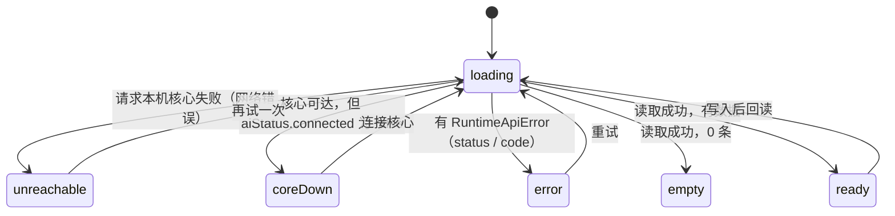

# 连接器 / 技能 / 设置 三块面板改版方案

状态：**待批准**。批准前不写业务代码。
日期：2026-10-16。
范围：只改右侧浮动面板里的「连接器」「技能」「设置（8 个分类）」三块的样式与交互。外壳、AI 对话页（DSH Host iframe）、其它页面不动。

前提沿用原 brief 的约束：

- 不合 main，不打包、不发 Release、不公证。
- 不做暗色和 i18n，不引整套带样式的重型 UI 库，不碰 IUI 接入。
- 不为单个设置字段硬编码，不用空值判断捂崩溃。
- 三块保持右侧浮动面板形态，不新造顶栏模块。
- 不杀用户的 `pnpm dev`。改了 BFF，就让用户点「重载核心」。

---

## 0. 到目前为止写了什么，逐项去留

改计划之前已经写了两批东西。第一批已推送并开了 PR。第二批只在本机工作区，没有提交，已收进 `git stash`。

### 0.1 分支 `cursor/surface-foundations`（已推送，已开 [PR #1](https://github.com/losebird/fde-x-desktop/pull/1)）

PR #1 是停工指令之前开的。本 run 没有再改它，也没有新开 PR。

| commit | 内容 | 文件 |
|---|---|---|
| `a51b5d6a` | 写入用户授权 | `AGENTS.md`、`PRODUCTION-SPEC.md`（新增 §0.6） |
| `38538802` | kit token、基础组件、ESLint、Playwright 脚手架 | 见下表 |

逐项建议：

| 项 | 文件 | 建议 | 理由 |
|---|---|---|---|
| 授权条款 | `AGENTS.md`、`PRODUCTION-SPEC.md` §0.6 | **保留，小改** | 文字已写清只放开三块，外壳和其它页仍按旧条款。要补两点。一是 §10 还写着「六分区锁死」，现网实际是 8 个分类，§0.6 要声明以现在的 8 个为基线、不再加。二是写明本方案路径。 |
| 设计 token | `src/index.css` 的 `--kit-*`，`tailwind.config.js` 的 `kit` 键 | **保留** | 只新增 `kit-*`，没动原有的 `brand`、`rounded`、`shadow-card`、`.btn`、`.card`。写的时候发现 `colors`、`borderRadius` 被重复定义，会冲掉全站色板，提交前已合并修好，并用脚本确认 `brand.DEFAULT` 还是 `#2F6B3A`。 |
| 按钮、输入框、选择框、开关、对话框、分段控件、左栏导航、数字卡、横幅、空状态、搜索框 | `src/components/surface/*.tsx` | **保留，等方向定了再微调** | 交互原语来自 Radix（无样式），样式全走 kit token，符合「不引带样式的重型库」。尺寸和密度要按第 2 节选定的方向再调。 |
| `Tabs.tsx` | `src/components/surface/Tabs.tsx` | **删除** | 推荐方向用不到它。已经有 `Segmented.tsx` 管分段切换，两个组件做同一件事。顺带去掉 `@radix-ui/react-tabs` 依赖。 |
| 报错改写 | `src/components/surface/humanize.ts`、`scripts/surface-humanize.check.ts` | **保留思路，改实现** | 现在按正则匹配错误原文，是黑名单，漏一条就把技术原文露给用户。`RuntimeApiError` 本来就带 `status` 和 `code`，应该先按这两项映射成文案，正则只兜底。网络断开（`TypeError: Failed to fetch`）单独归成「核心未接通」状态，不当成一条报错。 |
| ESLint | `eslint.config.js`，`pnpm lint` | **保留，扩大范围** | 现在只检查 `surface/` 和测试。验收要求 ESLint 通过，所以要把 `src/pages/MCP.tsx`、`Skills.tsx`、`Settings.tsx`、`src/components/settings/**` 纳进来。先只开这三块，不让全仓旧代码的告警挡路。 |
| Playwright | `playwright.config.ts`、`tests/visual/surfaces.spec.ts`，`pnpm visual` | **推翻测试用例，保留配置** | 用例用 `div.border-l.bg-surface` 找面板，绑死了外壳 `StagePanel` 的 className。外壳不准改，也不能靠给外壳加 `data-testid` 来解决。要改成按面板标题文字和 ARIA 角色定位。用例也从没跑过，没有基线截图。 |
| 依赖 | `package.json`、`pnpm-lock.yaml` | **保留，去掉 tabs** | 新增 `@radix-ui/react-dialog`、`react-slot`、`react-switch`，以及开发依赖 `eslint`、`typescript-eslint`、`eslint-plugin-react-hooks`、`@playwright/test`。 |
| `.gitignore` | 忽略 `test-results/`、`playwright-report/`、`blob-report/` | **保留** | 防止测试产物进库。 |

对 PR #1 的建议：保持打开。方案批准后，按上表在同一分支上补一个「修订」commit，再请验证官审。

### 0.2 分支 `cursor/settings-surface`（基于 PR #1，代码没有提交）

这个分支只有本方案文档这一个 commit。设置改版的半成品代码没有提交，已收进本机 stash：

- `stash@{1}`：`PR2 settings WIP (paused 2026-10-16, not committed)`，9 个已跟踪文件，+298 / −252 行。
- `stash@{0}`：`PR2 settings WIP untracked SettingsBlock (paused)`，新文件 `src/components/settings/SettingsBlock.tsx`。

stash 只存在这台云端 VM 上，VM 回收就没了。所以下表只当参考，批准后照方案重写。

| 改动 | 文件 | 建议 | 理由 |
|---|---|---|---|
| 设置读取改成 `loading / offline / ready` 三态，未接通时给引导和「再试一次」 | `use-host-settings.ts`、`HostNsPanel.tsx` | **保留思路，重写** | 方向对，能替掉「这一节没有可改的 Host 项」。但三态不够：「本机核心连不上」和「连上了但 DSH 没起来」要分开，空和错误也要分开。见 2.4 节的状态模型。 |
| 通知页的假开关改成禁用，并说明「核心还没有这个开关」 | `Settings.tsx` | **保留** | 原代码 `value={true} onChange={() => {}}` 是假开关，看上去能点、实际不保存，违反 §10「禁止假 Toggle」。这是正确性问题，与审美无关。 |
| 渲染器换成 kit 控件（布尔→开关，≤5 个枚举→分段，>5→下拉） | `SettingsDescribeForm.tsx` | **保留映射规则，重写** | 映射规则本身成立，见 2.4 节的表。但默认全部展开（`open=true`）是临时决定，没有验证，要按选定方向重新定。 |
| 左栏改成 148px 固定导航 | `Settings.tsx` | **推翻** | 写死 148px，面板很窄（最小 360px）时会挤内容。要按 2.3 节的容器宽度断点重做。 |
| 统一卡片 `SettingsBlock` | `SettingsBlock.tsx` | **保留** | 小组件，8 个分类都会用。 |
| 模型与提供方、插件、语义记忆的文案去技术化 | `CoreSettings.tsx`、`ModelsProvidersSection.tsx`、`SemanticSettings.tsx` | **保留文案，重做布局** | 去掉了 `/api/v1/ai/providers`、`4318`、`BFF` 等用户看不懂的原文。布局只是机械替换卡片，没设计。 |

### 0.3 环境改动（不进库）

- 在 `runtime/.host-generation` 装了 `@deepseek-ai/dsh@0.2.0-rc.2`。这个目录在 `.gitignore` 里。
- 安装时 npm 报 `EBADENGINE`：`undici@8.12.2` 和 `pi-ai` 要求 Node ≥ 22.19，VM 默认 Node 是 22.14。VM 里有 `nvm` 的 22.23.3，跑真后端要先切过去。
- **还没有接真后端，也没有截图、没有回读证据。** 前后对比截图要在批准后、动代码前先拍 main 的「改前」。

---

## 1. 要改的文件和模块

### 1.1 连接器

| 文件 | 改什么 |
|---|---|
| `src/pages/MCP.tsx`（约 600 行） | 拆分并重排：数字卡横排、服务器列表、详情、编辑表单、模板、空和错误状态。 |
| 新建 `src/components/connectors/*.tsx` | 从 `MCP.tsx` 拆出 `ServerList`、`ServerDetail`、`ServerEditor`、`TemplatePicker`。授权范围要在 §0.6 里加上这个目录。 |
| `src/lib/runtime-api.ts` | 只加「测试草稿连接」的调用方法（见 1.4 节），不改已有方法。 |
| `runtime/routes/mcp.mjs` | **可选**。见 1.4 节，需要你决定。 |

### 1.2 技能

| 文件 | 改什么 |
|---|---|
| `src/pages/Skills.tsx`（约 440 行） | 修重复显示，重做列表、详情、筛选、空状态，安装抽屉换成 kit 对话框。 |
| 新建 `src/components/skills/*.tsx` | 拆出 `SkillList`、`SkillDetail`、`SkillFiles`、`InstallDialog`。 |

重复显示的根因已经查清，不是数据重复。`Skills.tsx` 用 `@3xl:grid-cols-[1fr_360px]` 摆左右两栏，`active` 默认选中第一条。右侧面板通常只有 520px 宽，到不了 `@3xl` 断点，两栏就叠成一列。于是同一个 `officeToPdf` 先在列表里出现一次，下面的详情卡又出现一次。修法是改布局（窄面板用「列表进详情」），不是给数据去重。

### 1.3 设置（8 个分类）

| 分类 | 现在的代码 | 改什么 |
|---|---|---|
| 账户 | `Settings.tsx` 里的内联代码，加 `HostNsPanel home="account"` | 账户卡、导出、注销确认改用对话框，Host 项走渲染器。 |
| 外观 | `HostNsPanel home="appearance"` | 只走渲染器。深色仍然不可选（§10）。 |
| 通知 | `Settings.tsx` 内联 4 个开关 | 只有「早间 IM 静音」能写。另外 3 个禁用并说明原因。 |
| 快捷键 | `Settings.tsx` 内联表格 | 只读，换成 kit 排版。 |
| AI 核心 | `CoreSettings.tsx`、`ModelsProvidersSection.tsx`（约 1100 行）、`PresetImportDrawer.tsx`、`HostNsPanel home="core"` | 提供方列表、添加提供方、模型搜索、插件、Agent 预设，分成小节，统一状态。 |
| 语义记忆 | `SemanticSettings.tsx` | 分小节，表单校验，统一保存栏。 |
| 运行环境 | `Settings.tsx` 内联 `RuntimeRow`、`AuthorityCard` | 诊断列表加「重新检查」，状态语义统一。 |
| 存储与数据 | `Settings.tsx` 内联约 230 行 | 业务连接器表单、MCP 业务系统、存储说明、统计，拆成子组件。 |

结构调整：

- `Settings.tsx` 现在 600 多行，8 个分类挤在一个组件里。拆成 `src/components/settings/sections/{Account,Appearance,Notifications,Shortcuts,Core,Semantic,Runtime,Data}.tsx`，`Settings.tsx` 只留导航和分类切换。
- `SettingsDescribeForm.tsx` 只改渲染器。字段由 Host 的 `settings/describe` schema 决定，规则按「字段类型」写，不按「字段名」写。
- `src/lib/settings-schema.ts` 原则上不改。如果要读 schema 里的 `meta.title` / `meta.description` 当标签，就在这里加一个通用读取函数。
- `src/components/biz/BizHandleSlots.tsx`、`SkillBagPicker.tsx` 在授权范围外，「业务应用」页也在用。**不改它们的样式**，只在设置页外面包一层布局。

### 1.4 「测试连接」要不要动 BFF：需要你决定

现有接口 `GET /api/v1/mcp/health?serverName=` 只能查**已保存**的服务器（`runtime/routes/mcp.mjs` 第 589 行），没法在保存前测草稿。

- **做法 A：不动 BFF。** 编辑已有服务器时可以「测试连接」。新增时先保存，保存后自动测一次，失败就留在弹窗里显示原因，并提供「撤销添加」。缺点是会先写一次配置。
- **做法 B：加一个只读探测接口** `POST /api/v1/mcp/probe`，请求体就是草稿，直接调用已有的 `checkMcpHealth(entry)`，不写配置。缺点是改了 `runtime/`，你要点一次「重载核心」，还要过 Origin 白名单和超时限制。
- **推荐 B**，并单独拆成一个小 PR（见第 3 节的 PR3a），方便单独审安全性。不批准 B 就按 A 做。

---

## 2. 交互与信息架构

### 2.1 面板宽度是第一约束

三块都渲染在 `PanelContent` 里，外层是一个 `@container`。宽度的取值：

- 吸附在右侧时默认 520px，可以拖到 360px 到约 1280px。
- 「撕出」成浮窗时约 1180px。

所以布局只能按**容器宽度**分档，不能按视口。三档如下：

| 档 | 容器宽度 | 用途 |
|---|---|---|
| 窄 | < 560px | 默认吸附宽度。单列。 |
| 中 | 560–880px | 拖宽之后。单列加宽，或者窄的左右两栏。 |
| 宽 | ≥ 880px | 撕出的浮窗。完整的左右两栏。 |

### 2.2 三个竞争方向

**方向 A：单列列表加覆盖抽屉（Raycast 式）**
列表永远单列。点一行，从面板右边滑出一个覆盖层显示详情或编辑表单，盖住列表的大部分。

- 好处：任何宽度都一致，实现简单，窄面板最好用。
- 坏处：宽浮窗里浪费空间。详情盖住列表，没法边看列表边对比。抽屉叠抽屉（详情里再开编辑）会乱。

**方向 B：按容器宽度切换的「列表进详情」（Linear 设置式，推荐）**
窄档时，列表和详情是同一面板里的两层。点一行进入详情，顶部有「‹ 返回」。宽档时自动变成左列表、右详情，两栏并排。设置页的左栏导航同理：窄档变成顶部的下拉选择，中档和宽档是固定左栏。

- 好处：从根上消除技能的重复显示，同一时间只有一处在显示这条技能。宽浮窗里能并排看。和 Linear、Raycast 设置页的习惯一致。
- 坏处：要多维护一个「当前层」状态，窄档要处理返回。宽度切档时，选中项要保住。

**方向 C：分组列表加行内展开（macOS 系统设置式）**
没有单独的详情层。每一行点开就地展开，显示详情和操作。

- 好处：最省层级，适合设置页里字段少的分类。
- 坏处：连接器和技能的详情很长（工具列表、文件树、编辑器），展开后列表被撑得很长，也没法同时展开两个对比。技能现在的重复问题会以「展开行和列表行都显示名字」的形式变相留着。

取舍结论：

| 维度 | A 抽屉 | B 列表进详情 | C 行内展开 |
|---|---|---|---|
| 520px 窄面板 | 好 | 好 | 中 |
| 1180px 浮窗 | 差 | 好 | 中 |
| 技能重复显示 | 解决 | 根治 | 变相留着 |
| 长详情（工具、文件树） | 好 | 好 | 差 |
| 实现量 | 小 | 中 | 小 |

**推荐 B 做连接器和技能的主骨架。** 设置页的 8 个分类也用 B 的左栏切换。分类内部字段少的小节，比如 `SettingsDescribeForm` 的折叠块和插件的子组件，局部用 C 的行内展开。

### 2.3 线框图（方向 B）

#### 连接器：窄档，列表层

```
┌ 连接器 ────────────────────────────── [−][⇱][×] ┐  ← 外壳标题栏，不动
│ ┌──────────┬──────────┬──────────┐               │
│ │ 在线     │ 可用工具 │ 业务连接器│  ← 数字卡横排，三格等宽
│ │ 2 / 3    │ 14       │ 1        │
│ └──────────┴──────────┴──────────┘               │
│ [服务器 3] [业务连接器 1]          [重载] [+ 添加] │  ← 分段切换和主操作
│ ┌ 🔍 搜索名称、命令或地址 ────────────────────┐   │
│ └────────────────────────────────────────────┘   │
│ ┌────────────────────────────────────────────┐   │
│ │ ● mail          本机命令 · 6 个工具   [开] › │   │  ← 一行一台服务器
│ ├────────────────────────────────────────────┤   │     状态点、启停开关、进详情
│ │ ● playwright    本机命令 · 8 个工具   [开] › │   │
│ ├────────────────────────────────────────────┤   │
│ │ ○ rss-reader    网络地址 · 加载失败   [关] › │   │
│ └────────────────────────────────────────────┘   │
└──────────────────────────────────────────────────┘
```

「资源工具」不再单独占一个空区块，而是作为工具的一类，放进每台服务器的详情里。「本会话投影」改叫「可用工具」。

#### 连接器：窄档，详情层

```
┌──────────────────────────────────────────────────┐
│ ‹ 返回    mail                      [测试连接] […] │  ← […] 里是编辑、删除
│ ● 已加载 · 本机命令                                │
│ npx -y @mail/mcp                                 │
│ ─────────────────────────────────────────────── │
│ 工具 6                                            │
│  send_mail  list_inbox  read_mail  …             │
│ 资源 2                                            │
│  inbox://today  inbox://flagged                  │
│ ─────────────────────────────────────────────── │
│ ✓ 上次测试：3 秒前连接成功，响应 220ms             │
└──────────────────────────────────────────────────┘
```

#### 连接器：添加或编辑（对话框）

```
┌ 添加连接器 ──────────────────────────────── [×] ┐
│ 从模板开始                                        │
│ ┌────────┐┌────────┐┌────────┐┌────────┐          │  ← 来自 /api/v1/mcp/recipes
│ │ 邮件   ││Playwright││Computer││AI 热榜 │          │     和本机发现，不写死在前端
│ └────────┘└────────┘└────────┘└────────┘          │
│ 本机发现：claude-fs  github                       │
│ ─────────────────────────────────────────────── │
│ 名称      [ rss-reader            ]               │
│           只能用字母、数字、- 和 _，最多 32 个字    │  ← 逐项校验，就地报错
│ 连接方式  (本机命令) (网络地址)                    │
│ 启动命令  [ npx                   ]               │
│ 参数      [ -y                    ]  一行一个      │
│ 环境变量  [ TOKEN=…               ]               │
│           第 2 行缺少「=」                          │  ← 错误指到具体行
│ ─────────────────────────────────────────────── │
│ ✕ 连接失败：命令没有在 10 秒内响应                  │  ← 测试结果留在弹窗里
│                      [测试连接]  [取消]  [保存]    │
└──────────────────────────────────────────────────┘
```

现在的代码会把非法字符悄悄删掉再保存（`draft.name.replace(/[^A-Za-z0-9_-]/g, '')`），用户以为叫 `rss reader`，实际存成了 `rssreader`。改成就地报错，不偷偷改名。

#### 技能：宽档（浮窗），两栏

```
┌ 技能 ─────────────────────────────────────────────────────────────┐
│ [全部 12] [启用 9] [停用 3]   🔍 搜索技能        [+ 安装技能]      │
│ ┌──────────────────────────┐ ┌──────────────────────────────────┐ │
│ │ ▸ officeToPdf      启用  │ │ officeToPdf                [开]  │ │
│ │   把 Office 文件转成 PDF │ │ 把 Office 文件转成 PDF            │ │
│ │   docxToMd         启用  │ │ 触发词  转 pdf  导出 pdf          │ │
│ │   重命名照片       停用  │ │ 来源    工作区 · .dsh/skills/…    │ │
│ │   …                      │ │ 文件    SKILL.md  scripts/run.mjs │ │
│ └──────────────────────────┘ │                     [卸载]        │ │
│                              └──────────────────────────────────┘ │
└───────────────────────────────────────────────────────────────────┘
```

窄档时只显示左边的列表，点一行进入右边内容，顶部有「‹ 返回」。同一时间只有一处显示这条技能。

#### 设置：中档和宽档

```
┌ 设置 ──────────────────────────────────────────────────┐
│ ┌──────────┐ ┌───────────────────────────────────────┐ │
│ │ 账户     │ │ AI 核心                                │ │
│ │ 外观     │ │ ┌ 模型与提供方 ─────────── [重载核心] ┐ │ │
│ │ 通知     │ │ │ 43 个提供方 · 4 个已配置密钥       ▾ │ │ │
│ │ 快捷键   │ │ │ [+ 添加提供方] [+ 自定义提供方]      │ │ │
│ │▌AI 核心  │ │ └─────────────────────────────────────┘ │ │
│ │ 语义记忆 │ │ ┌ 插件 ───────────────────────────────┐ │ │
│ │ 运行环境 │ │ │ lan-assist        运行中        [开] │ │ │
│ │ 存储与数据│ │ │ semantic-os       运行中        [开] │ │ │
│ └──────────┘ │ └─────────────────────────────────────┘ │ │
│              │ ┌ 核心配置 ───────────────── 未保存 2 ┐ │ │  ← Host schema 生成
│              │ │ …                     [还原] [保存] │ │ │
│              │ └─────────────────────────────────────┘ │ │
│              └───────────────────────────────────────┘ │
└────────────────────────────────────────────────────────┘
```

窄档时，左栏变成内容顶部的一个下拉：`[ AI 核心 ▾ ]`。

#### 设置：核心未接通（替换「这一节没有可改的 Host 项」）

```
┌ 外观 ────────────────────────────────────────────┐
│ ┌╌╌╌╌╌╌╌╌╌╌╌╌╌╌╌╌╌╌╌╌╌╌╌╌╌╌╌╌╌╌╌╌╌╌╌╌╌╌╌╌╌╌╌╌┐ │
│ ╎ 核心还没接通                                    ╎ │
│ ╎ 主题和语言由本机核心保存。核心起来以后，          ╎ │
│ ╎ 这里会列出可以改的项目。                          ╎ │
│ ╎                    [连接核心]  [去运行环境查看]   ╎ │
│ └╌╌╌╌╌╌╌╌╌╌╌╌╌╌╌╌╌╌╌╌╌╌╌╌╌╌╌╌╌╌╌╌╌╌╌╌╌╌╌╌╌╌╌╌┘ │
└──────────────────────────────────────────────────┘
```

### 2.4 状态模型：每块都设计到这 6 种

原 brief 要求「未接通、空、加载、错误」四种状态都要设计。实际要分 6 种，因为「未接通」有两种原因，「有数据」也要算一种：



| 状态 | 用户看到 | 主操作 |
|---|---|---|
| `loading` | 骨架行，不闪空状态。已有缓存时显示缓存，右上角一个小转圈 | 无 |
| `unreachable` | 「连不上本机核心」引导卡 | 再试一次 |
| `coreDown` | 「核心还没接通」引导卡 | 连接核心 |
| `error` | 红色横幅，写清哪一步失败。正文里没有接口名、方法名 | 重试 |
| `empty` | 空状态插图位，配一句话和主按钮 | 添加 / 安装 |
| `ready` | 正常内容 | 无 |

这个模型用一个类型表达，在 `src/components/surface/` 里定义一次，三块共用。不在每个页面里各写一遍 `if`。

### 2.5 设置渲染器：按 schema 类型映射，不按字段名

| schema 类型 | 控件 | 校验 |
|---|---|---|
| `boolean` | 开关行（标签在左，开关在右） | 无 |
| `number` | 数字输入框 | 按 `meta.min` / `meta.max` / `meta.step` 就地提示 |
| `union`，常量选项 ≤ 5 个 | 分段控件 | 无 |
| `union`，常量选项 > 5 个 | 下拉选择 | 无 |
| `string`，并且在 `secrets` 里 | 密码框。已设过的显示「已配置」，不回读明文 | 无 |
| `string`，`meta.required` | 文本框 | 必填 |
| 全是标量字段的 `object` | 两列网格 | 逐项 |
| `dict` | 键值行，「添加键」不能和已有的键重名 | 键名不能为空、不能重复 |
| 标量 `array` | 标签输入 | 无 |
| 关联目录的字段（`joinCatalog`） | 目录选择器 | 无 |
| `const` | 只读文本 | 无 |
| 认不出来的对象 | JSON 编辑框 | JSON 解析失败时就地报错。现在的代码会把解析错误吞掉，用户改了也不生效 |

标签和说明的来源顺序：先用 schema 里的 `meta.title` / `meta.description`，没有才显示字段的键名。不为任何一个具体字段写特例。

每一节底部有一个保存栏，显示「未保存 N 项」，放「还原」和「保存」。保存时带上 `expectedRevision`。如果版本冲突，提示「这一节刚被别处改过」，并重新读取，不覆盖。

---

## 3. PR 拆分与顺序

按顺序堆叠。每个 PR 以前一个的分支为基，不合 main。


| PR | 内容 | commit 顺序 |
|---|---|---|
| **PR1 修订**（在已开的 #1 上追加） | 按 0.1 节：删 `Tabs` 和对应依赖；报错改写改成按 `code` / `status` 映射；状态模型类型；ESLint 扩到三块；Playwright 改成按标题和角色定位；§0.6 补 8 个分类基线和 `connectors/`、`skills/` 目录 | 1. 删减 2. 状态模型和报错 3. lint 范围 4. 测试定位 5. 文档 |
| **PR2 设置** | 先拍 main 上 8 页的「改前」截图；拆 `sections/*`（不改行为）；左栏和窄档下拉；渲染器；6 种状态；保存栏和版本冲突处理；通知页去掉假开关 | 1. 结构拆分（零行为变化） 2. 导航 3. 渲染器 4. 状态 5. 各分类排版 |
| **PR3a**（可选） | `POST /api/v1/mcp/probe`，复用 `checkMcpHealth`，只读、带超时、走 Origin 白名单；配一个 `runtime/*.check.mjs` | 1 个 commit |
| **PR3 连接器** | 数字卡横排；服务器和业务连接器分段；列表进详情；对话框编辑和逐项校验；模板（来自 recipes 和本机发现）；测试连接；文案去技术化 | 1. 拆组件 2. 列表和数字卡 3. 详情 4. 编辑和校验 5. 模板和测试 |
| **PR4 技能** | 修重复（列表进详情）；分类和筛选；详情和文件；安装对话框；术语统一为「技能」（页面上的 Skill、Skills 全部改掉） | 1. 拆组件 2. 布局修重复 3. 详情和文件 4. 安装 5. 术语 |

每个 PR 的规矩：一个 PR 一个负责人，一个分支一个写入者。改样式前先拍「改前」。commit 小而有序。作者不给最终结论，由验证官（换一个模型）判。

---

## 4. 验收标准与验证办法

### 4.1 功能不退化（接真后端）

每一项都要有「写操作之后回读存值」的证据，不能只看界面上的提示。

| 功能 | 操作 | 回读证据 |
|---|---|---|
| 加 MCP | 用模板添加一台 | `GET /api/v1/mcp` 列表里有它，profile 配置文件里有对应条目 |
| 改 MCP | 改参数后保存 | 同上，字段值已变 |
| 启停 MCP | 关掉再打开 | 列表里 `disabled` 和 `status` 跟着变 |
| 删 MCP | 删除 | 列表和配置文件里都没了 |
| 测试连接 | 对成功和失败各测一次 | 界面结果和 `/api/v1/mcp/health`（或 `probe`）返回值一致 |
| 装技能 | 从本机目录安装 | `listAiSkills` 里有它，磁盘上有对应目录 |
| 启停技能 | 切开关 | 重新读取后 `modelInvocable` 跟着变 |
| 改设置 | 在 8 个分类里，凡是能写的项都改一次 | `catalogBag('settings')` 回读的值等于新值，`revision` 加 1 |
| 重载核心 | 点「重载核心」 | `aiStatus().connected` 先断开、再变回 `true`，用户的 `pnpm dev` 没被杀 |

### 4.2 状态全覆盖

三块的每一页，都要截下 2.4 节的 6 种状态。

- `unreachable` 和 `error` 用 Playwright 的 `page.route` 拦截 `/api/v1/*` 来造，不去停进程。
- `coreDown` 用 `POST /api/v1/ai/disconnect` 来造。
- `empty` 用一个新的 `DSH_HOME` 来造。

### 4.3 专业级提升

每页都要有前后截图，放在同一宽度下对比：520px 吸附、880px 拖宽、1180px 浮窗。核对清单：

- 字号只用 kit 的 5 档，间距是 4 的倍数，圆角只用 `kit` 和 `kit-lg` 两档。
- 所有可点的东西都有悬停、按下、键盘焦点三种样式。
- 界面上不出现接口路径、方法名、英文报错原文。用一个脚本扫三块源码里的界面文案来查。
- 技能列表里同一个技能只出现一次。用 Playwright 断言 `getByText('officeToPdf')` 的数量等于 1（窄档），或者在宽档里列表和详情各 1。

### 4.4 自动检查

- `pnpm lint`：三块范围内 0 错误。
- `npx tsc -b`：主干上本来就有类型错误（`AppProductPage.tsx` 等）。验收标准是**三块相关文件里没有新增错误**，并且总数不比改前多。
- `pnpm check:surface`：报错改写的用例全过。
- `pnpm visual`：基线在批准的版本上生成。之后每个 PR 的差异要在 PR 描述里解释。

### 4.5 证据放哪

- 截图：`/opt/cursor/artifacts/ui-redesign/<pr>/{before,after}/<页面>-<宽度>-<状态>.png`
- 录屏或 Playwright trace：`/opt/cursor/artifacts/ui-redesign/<pr>/flows/`
- 回读证据：`/opt/cursor/artifacts/ui-redesign/<pr>/readback.json`，每条记操作、请求、回读值、时间。
- PR 描述里逐项引用这些路径。

### 4.6 真后端跑法

1. 切到 Node ≥ 22.19（VM 里用 `nvm use 22.23.3`）。
2. 确认 `runtime/.host-generation` 里已装 `@deepseek-ai/dsh@0.2.0-rc.2`。
3. `pnpm dev` 起 Vite 5174 和 BFF 4318。放进 tmux，不杀已有进程。
4. 带 `Origin: http://127.0.0.1:5174` 调 `POST /api/v1/ai/connect`，拉起 `dsh web`（profile `fde-x`，`DSH_HOME=~/.dsh-fde-x`）。

---

## 5. 风险

| 风险 | 落在哪个 PR | 怎么应对 |
|---|---|---|
| 规格互相打架：§10 写「设置六分区锁死」，现网是 8 个；§0.4 要求 className 不变 | PR1 | §0.6 明确写出以现在 8 个分类为基线、不再加，三块内 className 豁免。其余条款照旧。 |
| 共享组件被连带改坏：`Tag`、`Empty`、`BizHandleSlots`、`SkillBagPicker` 其它页也在用 | 全部 | 三块只用 `surface/` 里的新组件，不改共享组件。PR 描述里贴一张「业务应用」页的前后截图，证明没变。 |
| 面板宽度跨度大（360–1280px），一种布局撑不住 | PR2–4 | 按 2.1 节三档做，每档都截图。 |
| VM 的 Node 版本太低，真后端起不来 | 验证 | 先切 Node 22.23。起不来就停下报告，不拿假数据凑截图。 |
| VM 里没有模型密钥，AI 核心页「已配置密钥」是 0，有些流程走不到底 | PR2 | 如实标注。需要的话请你在 Cursor 后台 Secrets 里加一个测试密钥。 |
| 草稿探测接口（PR3a）会去连用户填的地址或命令 | PR3a | 只读、带超时、只接受白名单 Origin 的请求，不转发 Cookie。不批准就退回做法 A。 |
| Host schema 的 `meta.title` 可能缺失，标签退化成英文键名 | PR2 | 先在真后端上把 8 个分类的 schema 导出来看。缺得多就列一张清单，请 Host 侧补，不在前端按字段名硬写。 |
| 设置保存时版本冲突 | PR2 | 用 `expectedRevision`，冲突时提示并重新读取，不覆盖。 |
| 本机 stash 随 VM 回收丢失 | 0.2 节 | 半成品只当参考，按方案重写，不依赖它。 |
| PR #1 是停工指令之前开的，内容和本方案的修订有差 | PR1 | 批准后在同一分支追加修订 commit。不批准就由你决定是否关掉。 |
| 主干的 `tsc` 本来就是红的，看不出新增错误 | 全部 | 改前记下错误数和文件列表，改后对比。 |

---

## 需要你拍板的点

1. 方向：推荐 B（按宽度切换的列表进详情）。也可以选 A 或 C。
2. 测试连接：推荐做法 B（新增只读探测接口，单独 PR3a）。不批准就用做法 A（先保存再测，失败可撤销）。
3. PR #1：按 0.1 节在原 PR 上追加修订，还是关掉重开。
4. 授权范围：§0.6 要加上新建的 `src/components/connectors/**` 和 `src/components/skills/**` 两个目录。
