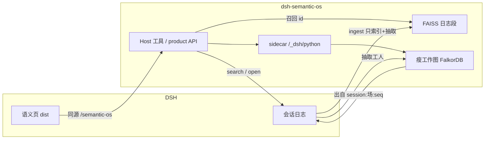
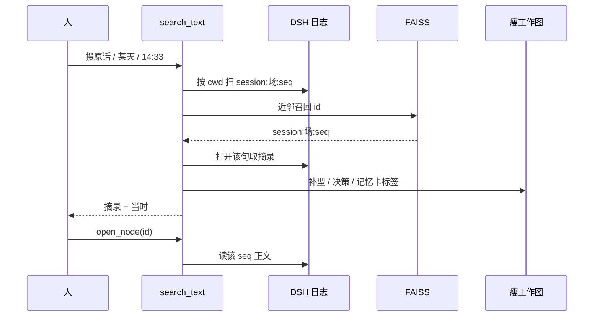
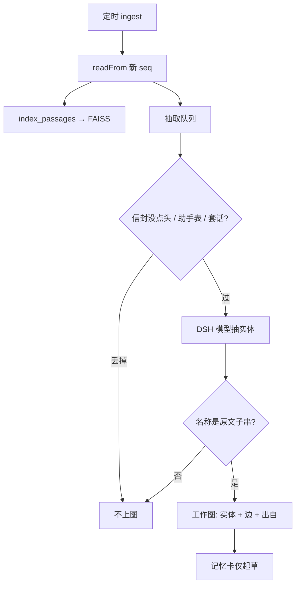

# 语义插件 · 架构与流程

用户装的是插件包（画面在 `dist/`）加离线运行时（`runtime-dist/`，Semantica 0.6.7）。不跑 Vite，不在语义页里现 pip。

## 四件套

| 角色 | 是什么 | 不是什么 |
|---|---|---|
| 书 | DSH 会话日志 `persistence.readFrom` | 不是图上的 Document 正文柜 |
| 目录 | `{cwd}/.dsh/semantic-os/passages/index.faiss` | 不是整图稠密向量、不会再涨到数 GB |
| 工作图 | FalkorDB 瘦图：型、实体、边、决策、记忆卡、`出自` | 不装日记全文 |
| 店面 | 本插件 `ui/` → `dist/` → `/semantic-os` | 不挂官方 Explorer 应用 |

## 问话怎么走

原话、钟点、出处都以日志为准。抽取结果不能当已过账。

## 新消息怎么进图

聊天正文不再 `upsert_documents`。日记只在日志里。

## 图谱页

`x/y` 只给画画。路径、SPARQL、SHACL、推理、检索不读坐标。

## 各功能吃什么

| 功能 | 依据 |
|---|---|
| 搜原话 / 几点钟 / 出处 | 日志 + FAISS 目录 |
| 图谱 / SPARQL / 路径 / 邻域 | 瘦工作图（抽取结果） |
| 词表 / 过审闸 | 手写 型，不是 NER |
| 已生效决策 | because + 回执 + 业务过账；抽取只是起草 |
| 现查单据 | 连接器在协助插件，行不进图 |
| 当前问题切片 | `search_text` 命中信封 + `missing`；不代现查 |
